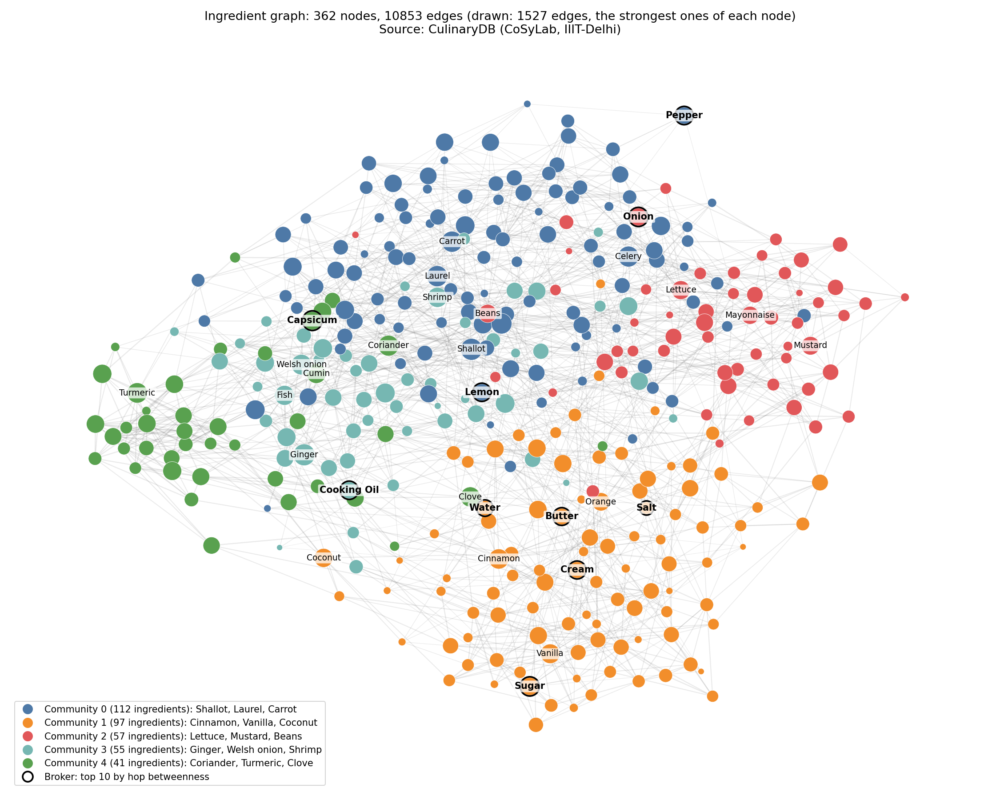
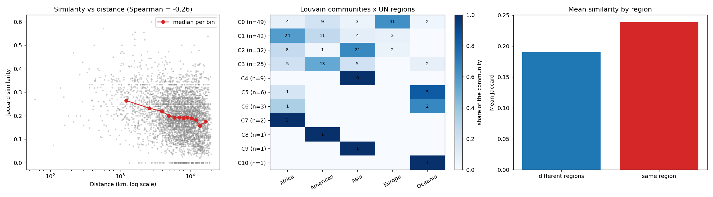
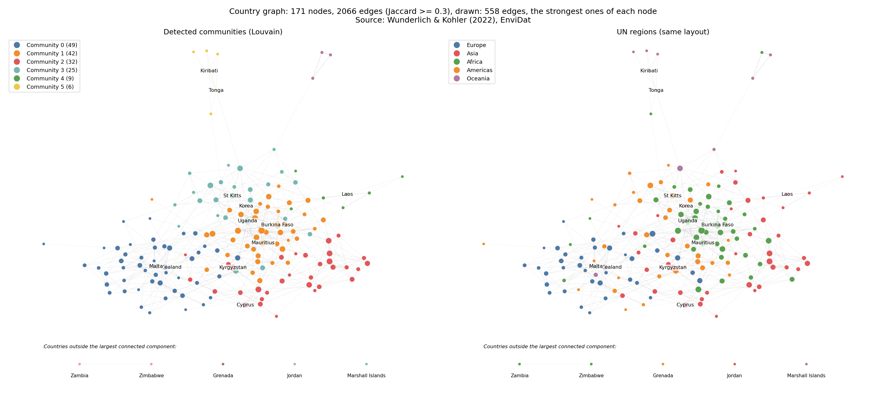
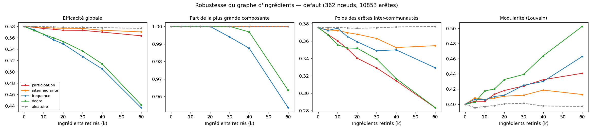

<div align="center">

# The Hidden Bridges of World Cuisines

### _Graph analysis of ingredient combinations and of the links between national cuisines_

<p><em>Which communities and connecting ingredients emerge from recipe data, and do the countries' cuisines line up with geography?</em></p>


<p><em>Built with:</em></p>


Group project, Graph Analytics course, Albert School, 2026

**[Slides](https://khad5addi.github.io/Graph-Analytics/) · [Results](#results) · [Architecture](#technical-architecture) · [Limitations](#limitations-and-residual-risks)**

</div>

> [!TIP]
> **Reproduce the whole analysis**
>
> 1. Install the dependencies with [uv](https://docs.astral.sh/uv/): `uv sync`
> 2. Move to the source folder: `cd src`
> 3. Run the pipeline in this order:
>
>    ```bash
>    uv run python build_graphs.py   # cleaning + both graphs -> data/processed/
>    uv run python analyze.py        # measures, Louvain, sensitivity (about 2 min)
>    uv run python robustness.py     # removal experiments on the ingredient graph
>    uv run python geography.py      # communities vs UN regions, similarity vs distance
>    uv run python visualize.py      # network figures (needs the output of geography.py)
>    uv run python seed_stability.py # Louvain stability over 30 seeds
>    uv run python pmi_justification.py # PMI vs counts on the same edges
>    uv run python brokers.py        # ingredient brokers and cut points in both graphs
>    uv run python shuffle_test.py   # country communities vs shuffled UN regions
>    uv run python brokers_extra.py  # country brokers, rank gaps and a second PMI distance
>    ```
>
> 4. Tables (CSV) and figures (PNG) are written to `outputs/`. All thresholds are parameters at the top of `src/build_graphs.py`.

---

## Table of contents

- [Project goal](#project-goal)
- [Features](#features)
  - [1. Data and cleaning](#1-data-and-cleaning)
  - [2. The ingredient graph](#2-the-ingredient-graph)
  - [3. The country graph](#3-the-country-graph)
  - [4. Measures required by the brief](#4-measures-required-by-the-brief)
  - [5. Communities, seed stability and PMI](#5-communities-seed-stability-and-pmi)
  - [6. Culinary proximity vs geography](#6-culinary-proximity-vs-geography)
  - [7. Extra analyses and visualisations](#7-extra-analyses-and-visualisations)
- [Results](#results)
- [Limitations and residual risks](#limitations-and-residual-risks)
- [Technical architecture](#technical-architecture)
- [Project structure](#project-structure)
- [Installation and setup](#installation-and-setup)
- [Data sources and versions](#data-sources-and-versions)
- [Technical decisions](#technical-decisions)
- [Use of AI](#use-of-ai)
- [Team](#team)

---

## Project goal

What communities and connecting nodes emerge from ingredient-based graphs of sampled recipes and countries?

Three objectives:

1. Identify groups of ingredients that are used together (Louvain communities), and check how stable they are.
2. Find the ingredients that connect these groups ("brokers", measured by betweenness), and see how much the ranking depends on how distance is defined.
3. Describe how the countries' communities line up with UN regions.

No data was collected by the team: every source is public, open, and cited. The closest prior work, which uses the same CulinaryDB data, is Caprioli et al. (2025); its code was not used (see [references](#data-sources-and-versions)). This project adds a second, country-level graph covering 171 countries.

## Features

### 1. Data and cleaning

| Source | Content | Licence | Folder |
| --- | --- | --- | --- |
| [CulinaryDB](https://cosylab.iiitd.edu.in/culinarydb/) (CoSyLab, IIIT-Delhi) | 45,772 recipes (45,749 with at least one ingredient), 26 cuisine labels, 695 distinct ingredients used, 456,279 recipe-ingredient pairs | CC BY-NC-SA 3.0 | `data/raw/culinarydb/` |
| National dishes of 171 countries, Wunderlich & Kohler (2022), [EnviDat](https://doi.org/10.16904/envidat.276), file `foodculture_dishes_rev2.csv` | 350 valid dishes (171 national dishes + 179 other dishes), 218 ingredient columns | ODbL + DbCL | `data/raw/envidat/` |
| Same EnviDat dataset, file `gravity_food_sim_final.csv` | distance, contiguity, common language, colonial ties, the authors' food-similarity measures | ODbL + DbCL | `data/raw/geography/` |
| UN M49 regions per ISO3 code ([lukes/ISO-3166-Countries-with-Regional-Codes](https://github.com/lukes/ISO-3166-Countries-with-Regional-Codes)) | region and sub-region of each country | see repository | `data/raw/geography/` |

Cleaning applied in [build_graphs.py](src/build_graphs.py) and [geography.py](src/geography.py):

- **CulinaryDB:** duplicate recipe-ingredient pairs are removed (456,279 to 412,560 pairs). Of the 103 compound ingredients (e.g. Garam Masala), 95 appear in recipes and 54 remain in the graph, where they are kept as nodes with a `compound` attribute. PMI is computed over the 45,749 recipes that have at least one ingredient.
- **EnviDat:** the CSV is `cp1252`-encoded with `;` separators; one empty row (351 rows in the file, 350 valid dishes) and one stray value (`58` in `coriander_cilantro`) are discarded.
- **Country codes:** EnviDat and CEPII use two obsolete ISO3 codes (`ZAR` to `COD`, `ROM` to `ROU`), mapped when joining with the UN regions. Joins use ISO3 codes, never country names. Typos present in the original data (e.g. "Roumania") are left untouched.

RecipeDB (IIIT-Delhi, about 118,000 recipes) was considered first. We used CulinaryDB's readily downloadable CSV bundle, from the same lab.

### 2. The ingredient graph

| | |
| --- | --- |
| Nodes | ingredients present in at least 50 recipes (362) |
| Construction | recipe-ingredient bipartite graph projected onto ingredients, edges kept if the pair shares at least 10 recipes, then the shared-recipe count is replaced by PMI and edges with PMI ≤ 0 are dropped |
| Weight | PMI = log2( c_ij · N / (c_i · c_j) ), with c_ij the recipes containing both ingredients, c_i and c_j those containing each one, and N = 45,749 |
| Type | undirected, simple, weighted (a repeated pair adds to one weighted edge) |

PMI is not part of the course; it is an explicit extension, justified in [section 5](#5-communities-seed-stability-and-pmi).

### 3. The country graph

| | |
| --- | --- |
| Nodes | the 171 countries |
| Country profile | union of the ingredients of **all** the country's dishes (alternative tested: national dish only) |
| Edges | Jaccard similarity of ingredient sets of at least 0.30 |
| Weight | Jaccard similarity |
| Type | undirected, simple, weighted |

### 4. Measures required by the brief

[analyze.py](src/analyze.py) computes, for each graph: number of nodes and edges, density, connected components, diameter and radius, clustering, degree and strength (weighted degree), betweenness, Louvain communities and modularity, and a sensitivity analysis to the thresholds.

Conventions:

- diameter and radius are computed on the **largest connected component** of the **unweighted** graph (number of hops);
- **hop betweenness** is the primary broker measure (every edge counts as one step; NetworkX normalises it by default, so values are shares of shortest paths);
- betweenness with distance 1 / weight is a sensitivity check (a stronger association means a shorter step; the weight is PMI for ingredients, Jaccard for countries);
- degree columns are raw degrees, not divided by n − 1;
- Louvain runs on the weighted graph with `seed=42`, and communities are **numbered by decreasing size** in every table and figure (ties broken by the alphabetically smallest member);
- the eigenvector centrality column is defined on the largest connected component only and is not used in the report.

### 5. Communities, seed stability and PMI

**Seed stability.** Louvain is a randomised heuristic, so [seed_stability.py](src/seed_stability.py) runs it with 30 seeds on each graph and saves the number of communities, the modularity range, and the groups of nodes that stay together in at least 27 of 30 runs (`outputs/louvain_*.csv`). No NMI or ARI is used for this.

**PMI.** [pmi_justification.py](src/pmi_justification.py) saves the numbers behind the choice of PMI: observed vs expected recipes for two pairs, and a comparison on the **same edges** between PMI weights and shared-recipe counts (`outputs/pmi_examples.csv`, `outputs/pmi_vs_counts.csv`).

### 6. Culinary proximity vs geography

[geography.py](src/geography.py) compares the country graph with UN regions and with distance:

- the contingency table of Louvain communities and UN regions (used in the report);
- NMI, ARI and a permutation test, kept in the repository only;
- Spearman correlation between Jaccard similarity and distance, and an OLS regression with log-distance, contiguity, common language, colonial tie and same region, kept in the repository only;
- list of culinarily close but distant country pairs, and of countries outside the majority region of their community;
- comparison with the similarity measures of the EnviDat authors (Manhattan and LSA). This comparison is circular for the national-dish version, which uses the authors' own dish data.

### 7. Extra analyses and visualisations

These stay in the repository and are not part of the report.

- [visualize.py](src/visualize.py) draws the network figures. For readability only the strongest edges of each node are drawn (a backbone); all measures use the full graphs. Node positions come from a force-directed layout and carry no geographic meaning. The ten ingredients with the highest hop betweenness are ringed.
- [robustness.py](src/robustness.py) removes k ingredients (k from 0 to 60 of 362) following six strategies (participation coefficient, hop betweenness, 1/PMI betweenness, frequency, degree, and random with 20 draws) and measures global efficiency, the share of nodes in the largest component, the weight of inter-community edges (original partition) and the modularity recomputed with Louvain. It is repeated on a sparser graph (PMI ≥ 0.5, at least 20 shared recipes).
- [fig_mesures.py](src/fig_mesures.py) draws the top-10 centrality bars and the degree distributions (`python fig_mesures.py`).
- [interactive.py](src/interactive.py) writes a standalone interactive page, `outputs/graphes_interactifs.html` (`python interactive.py`). It needs the outputs of `analyze.py` and `geography.py`.

[brokers_extra.py](src/brokers_extra.py) writes country centralities, ingredient betweenness-versus-degree rank gaps, a second PMI-distance comparison and summary measures to `outputs/brokers_extra_*.csv` for the report additions.

[cuisine_check.py](src/cuisine_check.py) is an extra check not used in the report, comparing ingredient communities with cuisine labels through occurrence ratios, top and bottom cuisines, a label-shuffle test with a majority baseline, and a slide heatmap (`outputs/cuisine_community_ratio.csv`, `outputs/cuisine_community_top.csv`, `outputs/cuisine_shuffle_test.csv`, `outputs/cuisine_community_heatmap.png`).

## Results

### Global measures

| Measure | Ingredients | Countries (Jaccard ≥ 0.30) |
| --- | ---: | ---: |
| Nodes | 362 | 171 |
| Edges | 10,853 | 2,066 |
| Density | 0.166 | 0.142 |
| Connected components | 1 | 5 |
| Largest component | 362 | 166 |
| Diameter / radius (largest component) | 3 / 2 | 6 / 3 |
| Average clustering | 0.591 | 0.478 |
| Louvain communities (seed 42) | 5 | 11 |
| Modularity (seed 42) | 0.400 | 0.286 |

Source: [analyze.py](src/analyze.py); tables in `outputs/ingredients_nodes.csv` and `outputs/countries_nodes.csv`.

### Ingredient communities and their stability



| Community | Size | Strongest ingredients |
| --- | ---: | --- |
| 0 | 112 | shallot, bay laurel, carrot, celery, thyme, fennel, parsley, mushroom |
| 1 | 97 | cinnamon, vanilla, coconut, orange, nutmeg, raisin, sugar, honey |
| 2 | 57 | lettuce, mustard, beans, mayonnaise, onion, beef, pork |
| 3 | 55 | ginger, welsh onion, shrimp, fish, soy sauce, lime, sesame, coconut milk |
| 4 | 41 | coriander, turmeric, clove, cumin, chickpea, cayenne, peas |

The table lists the ingredients with the highest strength in each community. We did not check the communities against cuisine labels, so we describe them by their ingredients only.

Seed stability over 30 seeds ([louvain_seed_summary.csv](outputs/louvain_seed_summary.csv)):

| Graph | Communities (30 seeds) | Modularity range | Seed 42 | Groups staying together in ≥ 27 of 30 runs |
| --- | --- | --- | --- | --- |
| Ingredients | 4 to 6 (5 in 28 runs) | 0.389 to 0.402 | 5 communities, 0.400 | 13 groups covering 349 of 362 ingredients; the 5 largest have 109, 95, 44, 43 and 39 ingredients |
| Countries | 9 to 11 (11 in 21 runs) | 0.271 to 0.288 | 11 communities, 0.286 | 14 groups covering 154 of 171 countries; the 4 largest have 43, 28, 27 and 18 countries |

The five ingredient groups are therefore stable, while single rankings of individual nodes are not guaranteed to be: with the participation coefficient (kept in the repository only), the list of top ingredients changes with the seed (okra is in the top 12 in 10 of 30 runs, cumin in 8, ginger in 28).

### Why PMI

| Pair | Recipes together | Expected if independent | Ratio |
| --- | ---: | ---: | ---: |
| Salt – Garlic | 7,571 | 6,554 | 1.16 |
| Ginger – Soybean Sauce | 1,010 | 226 | 4.46 |

Counts say which pairs are common (Salt and Garlic are in many recipes together); PMI says which pairs are more common than their frequencies predict (Ginger and Soybean Sauce). A positive PMI is not a significance test. On the **same 10,853 edges**, with shared-recipe counts as weights Louvain finds 3 communities (modularity 0.274); with PMI weights it finds 5 (modularity 0.400). The modularities of two graphs with different edges are not comparable, which is why the edge set is held fixed. If PMI cannot be defended, the shared-recipe projection is the fallback ([pmi_vs_counts.csv](outputs/pmi_vs_counts.csv)).

### Brokers: betweenness vs frequency

| Rank | Hop betweenness (primary) | Frequency (recipes) | 1/PMI betweenness (sensitivity) | Frequency (recipes) |
| ---: | --- | ---: | --- | ---: |
| 1 | Water | 10,128 | Couscous | 245 |
| 2 | Salt | 18,745 | Lasagna | 206 |
| 3 | Butter | 12,656 | Shallot | 2,101 |
| 4 | Lemon | 4,168 | Coconut | 906 |
| 5 | Cream | 6,022 | Saffron | 576 |

Spearman correlation with ingredient frequency: 0.968 for hop betweenness and 0.323 for 1/PMI betweenness (0.955 for degree). Frequency and edges come from the same recipes, so the correlation is read descriptively: when every edge counts as one step, the very common ingredients sit on the shortest paths; when a stronger association means a shorter step, strongly associated but less frequent ingredients lead instead. Those leaders hold under that distance choice only. Source: [analyze.py](src/analyze.py), `outputs/ingredients_nodes.csv`.

### Sensitivity to the thresholds

Ingredient graph (selection from [sensibilite_ingredients.csv](outputs/sensibilite_ingredients.csv)):

| Min. co-occurrence | PMI threshold | Edges | Components | Louvain communities | Modularity |
| ---: | ---: | ---: | ---: | ---: | ---: |
| 10 (**chosen**) | 0.0 | 10,853 | 1 | 5 | 0.400 |
| 10 | 0.5 | 7,745 | 1 | 5 | 0.423 |
| 10 | 1.0 | 4,910 | 2 | 7 | 0.477 |
| 20 | 0.0 | 7,873 | 3 | 8 | 0.414 |
| 50 | 0.0 | 4,522 | 40 | 44 | 0.441 |

Country graph, all-dishes profile ([sensibilite_pays.csv](outputs/sensibilite_pays.csv)):

| Jaccard threshold | Edges | Components | Largest component | Louvain communities | Modularity |
| ---: | ---: | ---: | ---: | ---: | ---: |
| 0.20 | 7,447 | 1 | 171 | 4 | 0.123 |
| 0.25 | 4,466 | 3 | 169 | 7 | 0.183 |
| **0.30 (chosen)** | 2,066 | 5 | 166 | 11 | 0.286 |
| 0.35 | 835 | 17 | 153 | 23 | 0.437 |
| 0.40 | 331 | 36 | 130 | 41 | 0.600 |

Each threshold gives a different graph, so modularity values are not directly comparable and cannot choose the threshold on their own. The chosen values are a compromise that keeps the graph connected (or nearly so) while showing structure; for ingredients, going from PMI 0.0 to 0.5 raises modularity from 0.400 to 0.423 while the graph stays connected.

### Culinary proximity vs geography



Communities by UN region ([geo_contingence.csv](outputs/geo_contingence.csv)):

| Community (size) | Africa | Americas | Asia | Europe | Oceania |
| --- | ---: | ---: | ---: | ---: | ---: |
| 0 (49) | 4 | 9 | 3 | 31 | 2 |
| 1 (42) | 24 | 11 | 4 | 3 | 0 |
| 2 (32) | 8 | 1 | 21 | 2 | 0 |
| 3 (25) | 5 | 13 | 5 | 0 | 2 |
| 4 (9) | 0 | 0 | 9 | 0 | 0 |
| 5 (6) | 1 | 0 | 0 | 0 | 5 |

Communities 6 to 10 have 3, 2, 1, 1 and 1 countries. 110 of the 171 countries (64.3 %) sit in the majority region of their community; the 61 others are listed by `geography.py`.



Repository-only measures ([geography.py](src/geography.py)):

| Comparison | Value |
| --- | ---: |
| NMI / ARI, communities vs UN regions (5 classes) | 0.352 / 0.251 |
| NMI / ARI, communities vs UN sub-regions (17 classes) | 0.433 / 0.179 |
| Spearman(Jaccard, distance), 14,535 country pairs | −0.256 |
| Spearman restricted to pairs ≥ 3,000 km | −0.156 |
| OLS R² (log-distance, contiguity, language, colony, same region) | 0.087 |
| Mean Jaccard, same region / different regions | 0.239 / 0.190 |

### Robustness of the ingredient graph (repository only, k = 60 ingredients removed)



| Strategy | Global efficiency | Largest component | Inter-community edge weight | Modularity |
| --- | ---: | ---: | ---: | ---: |
| none (reference) | 0.580 | 1.000 | 0.376 | 0.400 |
| random (mean of 20 draws) | 0.577 | 1.000 | 0.377 | 0.401 |
| participation coefficient | 0.563 | 1.000 | 0.283 | 0.441 |
| hop betweenness | 0.440 | 0.964 | 0.278 | 0.509 |
| 1/PMI betweenness | 0.570 | 1.000 | 0.355 | 0.413 |
| frequency | 0.437 | 0.954 | 0.329 | 0.463 |
| degree | 0.442 | 0.964 | 0.284 | 0.503 |

On the sparser graph (PMI ≥ 0.5, at least 20 shared recipes; reference 0.488 / 0.983 / 0.348 / 0.441): participation 0.441 / 0.974 / 0.212 / 0.530, hop betweenness 0.281 / 0.844 / 0.239 / 0.570, 1/PMI betweenness 0.435 / 0.960 / 0.322 / 0.471, frequency 0.262 / 0.801 / 0.291 / 0.523, degree 0.295 / 0.864 / 0.250 / 0.562, random 0.478 / 0.979 / 0.348 / 0.444.

Removing ingredients chosen by hop betweenness, frequency or degree damages global efficiency much more than removing random or 1/PMI-betweenness ingredients, which matches the finding that hop betweenness follows frequency. The inter-community column is partly circular for the participation strategy, which is defined with the same partition.

### Key findings

- **The ingredient graph has five communities in 28 of 30 seeds**, and five groups of ingredients stay together almost every time. They are described by their ingredients (herbs and aromatics, sweet and baking, sauces and salads, ginger and soy sauce group, spices), not by cuisine names.
- **Betweenness depends on how distance is defined.** With hop distances it follows frequency (Spearman 0.968; Water, Salt, Butter); with 1/PMI distances it does not (0.323; Couscous, Lasagna, Shallot). The ingredient graph has no articulation point and no bridge.
- **PMI changes the picture compared with raw counts:** on the same edges, 5 communities instead of 3.
- **Country communities partly line up with UN regions.** East Asia (9 of 9 countries in Asia) and the Pacific (5 of 6 in Oceania) form clear blocks; the largest communities mix Europe with the Americas and Africa with the Americas. 64.3 % of countries sit in the majority region of their community. This is descriptive and not causal.
- **Distance explains little of country similarity** (Spearman −0.26, R² = 0.09 in the repository-only regression).

## Limitations and residual risks

- **Single-seed rankings:** the partition used for the tables and figures is the one for seed 42. The community counts and the five large ingredient groups are stable over 30 seeds, but rankings that depend on one partition (such as the participation-coefficient list) are not.
- **Small country profiles:** median 16 ingredients, 20 countries with 8 or fewer. A few ingredients decide whether an edge passes the Jaccard threshold: Palau and Seychelles (7 ingredients each) have a Jaccard of 1.000, and the five countries outside the largest component, as well as small countries such as Tonga and Tuvalu, are likely effects of the data and the threshold.
- **Imbalanced CulinaryDB:** USA 16,118 recipes and Italy 7,504, against 15 and 14 for the smallest "Misc." groups. PMI and Louvain results reflect these cuisines more than the others. Cuisine labels were not used to check the communities.
- **Frequency comparison:** frequency and edges come from the same recipes, so correlations between centralities and frequency are descriptive.
- **Circular checks:** the 0.971 correlation with the authors' similarity reuses their own national-dish data; the inter-community edge weight in the robustness experiment uses the same partition that defines the participation-coefficient list.
- **Dependent observations:** country pairs are not independent, so classical p-values of the regression are not reported.
- **Snapshot data:** EnviDat data were collected from 4 June to 23 August 2018.
- **Not a causal claim:** a shared ingredient list does not prove a historical or cultural link.

## Technical architecture

```text
┌──────────────────────────────────────────────────────────────┐
│ CulinaryDB (45,772 recipes)      EnviDat (171 countries)      │
└───────────────┬──────────────────────────┬───────────────────┘
                ↓                          ↓
     Cleaning, recipe sets       Country profiles (all dishes)
                ↓                          ↓
   Co-occurrence matrix -> PMI      Jaccard similarity matrix
   (>= 10 recipes, PMI > 0)         (threshold 0.30)
                ↓                          ↓
        Ingredient graph             Country graph
        (362 nodes, 10,853 edges)    (171 nodes, 2,066 edges)
                └────────────┬─────────────┘
                             ↓
   Measures, Louvain (numbered by size), 30-seed stability, sensitivity
                             ↓
     ┌───────────────────────┴───────────────────────┐
     ↓                                               ↓
Betweenness (hop, 1/PMI) vs frequency      UN regions: contingence table
PMI justification                          (distance, NMI, OLS: repository only)
Removal experiments (repository only)
     └───────────────────────┬───────────────────────┘
                             ↓
                 outputs/ (CSV tables and figures)
```

## Project structure

```text
.
├── README.md
├── pyproject.toml                    # project metadata and dependencies (uv)
├── uv.lock                           # exact locked versions
├── .python-version                   # Python 3.12
├── data/
│   ├── raw/
│   │   ├── culinarydb/               # 4 CSV files (+ original zip)
│   │   ├── envidat/                  # foodculture_dishes_rev2.csv
│   │   └── geography/                # gravity_food_sim_final.csv, un_regions_all.csv
│   └── processed/                    # ingredient_graph.graphml, country_graph.graphml
├── src/
│   ├── build_graphs.py               # cleaning and construction of both graphs (parameters at the top)
│   ├── analyze.py                    # required measures, Louvain, betweenness, sensitivity
│   ├── seed_stability.py             # Louvain over 30 seeds
│   ├── pmi_justification.py          # observed vs expected recipes, PMI vs counts on the same edges
│   ├── robustness.py                 # removal experiments on the ingredient graph (repository only)
│   ├── geography.py                  # communities vs UN regions, similarity vs distance
│   ├── visualize.py                  # network figures
│   ├── brokers.py                    # ingredient brokers and cut points in both graphs
│   ├── shuffle_test.py               # country communities vs shuffled UN regions
│   ├── brokers_extra.py              # country brokers, rank gaps and a second PMI distance
│   ├── cuisine_check.py              # extra cuisine-label check, tables and heatmap (not used in the report)
│   ├── fig_mesures.py                # centrality and degree figures (extra)
│   ├── interactive.py                # interactive explorer, HTML (extra)
│   └── interactive_template.html     # page template used by interactive.py
├── slides/                           # oral presentation (Slidev), published to GitHub Pages
└── outputs/
    ├── ingredients_nodes.csv         # node table (degree, strength, betweenness, community, ...)
    ├── countries_nodes.csv
    ├── sensibilite_ingredients.csv   # sensitivity to the thresholds
    ├── sensibilite_pays.csv
    ├── louvain_*.csv                 # 30-seed stability
    ├── pmi_*.csv                     # PMI justification
    ├── robustesse_*.csv / .png       # removal experiments
    ├── geo_*.csv, geographie.png     # geography analysis
    └── fig_*.png, graphes_interactifs.html
```

## Installation and setup

Prerequisites: [uv](https://docs.astral.sh/uv/getting-started/installation/). uv installs Python 3.12 (the version used for all results) by itself if it is missing. No GPU or API key is needed.

1. Create the virtual environment and install the locked dependencies:

   ```bash
   uv sync
   ```

   `uv.lock` pins the exact library versions used for the results below. If you need a pip-style file, run `uv export --no-hashes -o requirements.txt`.

2. Check that the raw data are in `data/raw/` (they are versioned in this repository). If not, download them from the links in [Data sources and versions](#data-sources-and-versions).

3. Run the pipeline from the `src/` folder:

   ```bash
   cd src
   uv run python build_graphs.py
   uv run python analyze.py
   uv run python robustness.py
   uv run python geography.py
   uv run python visualize.py
   uv run python seed_stability.py # Louvain stability over 30 seeds
   uv run python pmi_justification.py # PMI vs counts on the same edges
   uv run python brokers.py        # ingredient brokers and cut points in both graphs
   uv run python shuffle_test.py   # country communities vs shuffled UN regions
   uv run python brokers_extra.py  # country brokers, rank gaps and a second PMI distance
   ```

   `analyze.py` takes about 2 minutes (the sensitivity analysis rebuilds the graph for each threshold). On Windows, set `PYTHONIOENCODING=utf-8` if the console fails on accented country names. `seed_stability.py` and `pmi_justification.py` each take under a minute; `fig_mesures.py` and `interactive.py` are optional extras (see [section 7](#7-extra-analyses-and-visualisations)).

4. Optional, the slides of the oral (Node.js 22 or later): `cd slides && npm install && npm run dev`, then open http://localhost:3030. The published version is at https://khad5addi.github.io/Graph-Analytics/ (arrow keys to move).

## Data sources and versions

| Source | Reference |
| --- | --- |
| CulinaryDB | CoSyLab, IIIT-Delhi. https://cosylab.iiitd.edu.in/culinarydb/ (CC BY-NC-SA 3.0) |
| National dishes, food similarity, gravity variables | Wunderlich, A. & Kohler, A. (2022). *Data of national dishes, their similarity and trade flows.* EnviDat. doi:10.16904/envidat.276 (ODbL + DbCL) |
| UN regions | lukes/ISO-3166-Countries-with-Regional-Codes, `all/all.csv` (repository version and licence to be recorded) |
| Prior work | Caprioli et al. (2025). *The networks of ingredient combinations as culinary fingerprints of world cuisines.* npj Science of Food 9, 242. doi:10.1038/s41538-025-00588-4. Same CulinaryDB data; **its code was not used**. |
| Louvain | Blondel, V. D., Guillaume, J.-L., Lambiotte, R. & Lefebvre, E. (2008). Fast unfolding of communities in large networks. *J. Stat. Mech.* P10008. doi:10.1088/1742-5468/2008/10/P10008 |
| Software | Hagberg, A. A., Schult, D. A. & Swart, P. J. (2008). Exploring network structure, dynamics, and function using NetworkX. *SciPy 2008*, 11–15. NetworkX 3.7 documentation. |

Python libraries (versions used): networkx 3.7, pandas 3.0.2, numpy 2.4.4, scipy 1.17.1, matplotlib 3.10.0, scikit-learn 1.8.0. Data in `data/raw/` keeps its original licence (attribution, non-commercial where stated, share-alike).

## Technical decisions

### Why CulinaryDB rather than RecipeDB or web scraping?

CulinaryDB comes with a readily downloadable CSV bundle, is open and citable, and comes from the same lab as RecipeDB. Scraping recipe sites raises copyright and terms-of-use issues and would have consumed a large share of the ten available days.

### Why PMI as the ingredient edge weight?

Shared-recipe counts are dominated by ubiquitous ingredients (salt, pepper, garlic). PMI asks instead which pairs appear together more often than their frequencies predict (Ginger and Soybean Sauce occur 4.46 times more often than chance, Salt and Garlic only 1.16 times). On the same edges, PMI gives 5 communities and counts give 3. A minimum number of shared recipes (10) limits the well-known instability of PMI for rare pairs. PMI is not taught in the course, so it is presented as an explicit extension; the raw-count projection is the fallback.

### Why Jaccard similarity for countries, with a 0.30 threshold?

Jaccard compares ingredient sets without counts, which suits binary dish data. At 0.20 or below, the graph is dense (density above 0.5) and modularity is only 0.12; from 0.35 upward, it breaks into 17 or more components. 0.30 is a compromise that keeps 166 of 171 countries in one component while showing structure.

### Why use all dishes of a country instead of the national dish only?

The national dish alone gives about ten ingredients per country, which makes Jaccard very noisy. Both variants were built and compared: the all-dishes profile produces a better-connected graph.

### Why hop betweenness as the primary broker measure, and 1/PMI as a check?

Hop betweenness is the version taught in the course, with every edge counting as one step. Using 1/PMI as a distance means a stronger association is a shorter step, which is a modelling choice. Comparing both shows how much the ranking depends on it (Spearman with frequency 0.968 against 0.323). Other transformations were not tried: −log(PMI) can be negative and max − PMI gives zero-length edges.

### Why Louvain, with a fixed seed and a 30-seed check?

Louvain handles weighted graphs and is available in NetworkX. The partition depends on the random seed, so `seed=42` makes the tables reproducible and the 30-seed run shows how much the community count and modularity vary.

### Why draw only a backbone in the figures?

With 10,853 edges the full graph is an unreadable blob. The figures keep the strongest edges of each node (6 per node for ingredients, 5 for countries) for the layout and the drawing, while all measures use the complete graphs.

## Use of AI

An AI assistant (Claude, Anthropic) was used to help choose the data sources, write the analysis code and figures, and draft this README. The team reviewed the design choices, thresholds and interpretations. No code from other projects was copied. A fuller account of how AI tools were used is given in the report, in the section "Reused code and use of AI".

## Team

Roles as agreed in the project roadmap:

- **Khadidja Addi**: data and cleaning, graph construction (PMI and Jaccard), required statistics, Louvain communities and seed stability, repository and README.
- **Ewan Kapoor**: betweenness and brokers, country communities versus UN regions, report skeleton, slides.

---

**Version 1.0** · Graph Analytics project, Albert School, 2026
